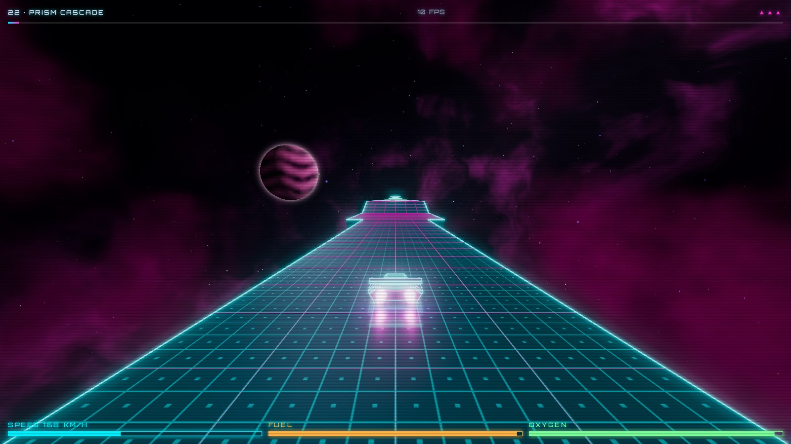
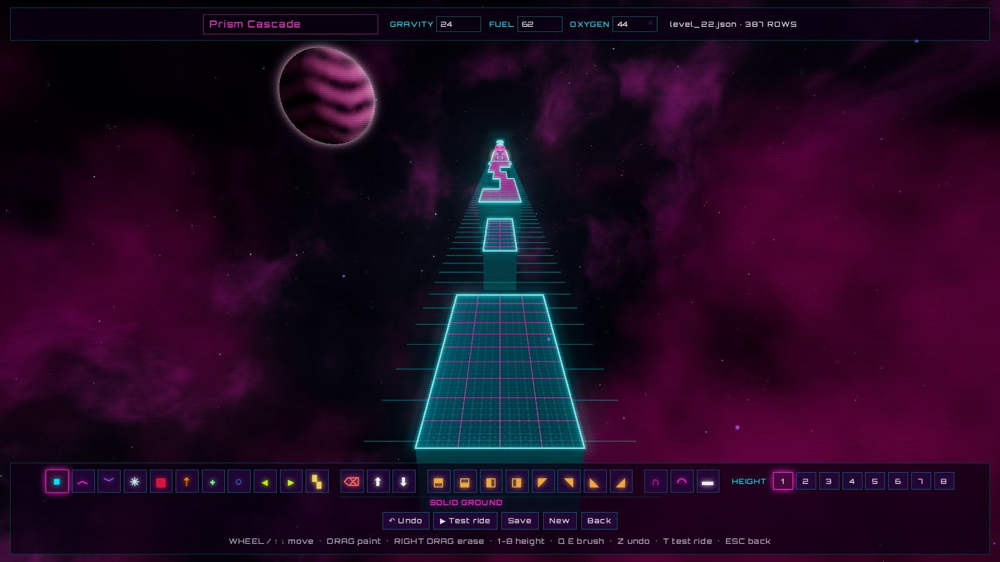

# synthride

[](https://github.com/rguillon/synthride/actions/workflows/main.yml?query=branch%3Amain)
[](https://codecov.io/gh/rguillon/synthride)
[](https://img.shields.io/github/commit-activity/m/rguillon/synthride)
[](https://img.shields.io/github/license/rguillon/synthride)

**SynthRide** is a 3D sky racer with a synthwave / cyberpunk look, inspired by SkyRoads (1993). Steer a ship along
neon tracks floating in space: jump the gaps, ride the ramps, thread the tunnels, and keep an eye on your fuel
and oxygen until you cross the finish line.



The whole game is written in Python and **runs entirely in the browser**. A tiny Python server packages it into an
HTML5 page that boots [Pyodide](https://pyodide.org) (CPython compiled to WebAssembly) and renders it with
[Three.js](https://threejs.org).

- **GitHub repository**: <https://github.com/rguillon/synthride/>
- **Play online**: <https://rguillon.github.io/synthride/>
- **Documentation**: <https://rguillon.github.io/synthride/docs/>

## Features

- **28 levels**, from *Neon Highway* to *Terminal Velocity*, each under its own sky: nebula colours, a planet and
  sometimes a moon.
- **Tracks built from blocks** 8 wide and up to 8 high: boost and slow strips, ice, kill blocks, jump pads, side
  pushers, refuel and oxygen pads, ramps and banked corners, square and round tunnels.
- **Arcade physics**: per-level gravity, jumps with one double jump, ramps that launch you over gaps, and corner
  clips that nudge you aside instead of killing you.
- **Neon visuals**: bloom glow, animated markings on the special blocks, the ship mirrored in the track, and sparks.
- **Procedural sound**: a synthwave song sequenced live with WebAudio (bass, pad, lead and drums), plus synthesized
  sound effects.
- **A 3D level editor**: paint the track with brushes, test-ride it at once, and save it straight into the game's
  level files.

## Play

```bash
make install        # once: create the virtual environment
make serve          # then open http://127.0.0.1:8000
```

Press `Enter` on the title screen, choose a level with the arrow keys and press `Enter` to ride.

| Key | Action |
| --- | --- |
| `↑` / `W` | accelerate |
| `↓` / `S` | brake |
| `←` `→` / `A` `D` | strafe |
| `Space` | jump; press again in mid-air for one double jump |
| `Esc` | back to level select |
| `M` | mute music |

### Rules

- The track is 8 blocks wide and made of blocks of different heights and effects. Each special block carries an
  animated marking that shows what it does, and the level select screen has a key:

  | Block | Look | Effect |
  | --- | --- | --- |
  | normal | cyan | solid ground |
  | boost | pink, chevrons racing forward | speed burst above top speed |
  | slow | violet, chevrons crawling back | caps your speed |
  | kill | red, flashing hazard stripes | burns the ship |
  | jump pad | orange, target and rising arrows | launches the ship high into the air |
  | ice | white, drifting crystals | no grip: sideways speed changes only slowly |
  | pusher | lime, arrows streaming sideways | drifts the ship left or right |
  | refuel | green, pulsing plus | refills fuel |
  | air | blue, bubbles | refills oxygen |
  | finish | gold checker | ends the level |

- Blocks can be **ramps**: sloped up or down the track, banked to one side, or cut as corners. A ship leaving the top
  of a ramp keeps its climb, so a ramp ending over a gap is a kicker.
- Blocks can carry a **tunnel**, square or round. Side-by-side tunnel blocks merge into one wide tunnel. Its walls
  stop you, jumping inside bumps your head on the roof, flying into its front edge is a crash, and you can ride
  on top of it.
- Fuel burns as you travel and oxygen runs out with time; the HUD shows both, with your speed and progress.
- Falling off the track, hitting a block head-on, riding a kill block, or running out of fuel or oxygen costs a life
  and restarts the level. Clipping a block with only a corner of the ship nudges you sideways instead.
- You have 3 lives. Finishing a level takes you to the next one, and finishing the last level wins the game.

## Level editor

```bash
make serve-dev      # or: uv run synthride serve --dev
```

The dev server adds the level editor. Press `E` on the title screen to start a new track, or on a level in the
level select to edit that level. The editor shows the track in 3D from a raised camera, with the brushes below.



- **Move along the track** with the mouse wheel, or `↑` `↓`.
- **Paint**: press on the track, drag and release. The whole rectangle between the two cells gets the brush.
  A right drag erases.
- **Height**: pick 1 to 8 (or press the digit) for the new tiles painted over gaps. Painting a tile brush over
  existing tiles changes their type and keeps their height, so a raised section can be turned to ice in one stroke.
  A faint grid shows the brush height past the end of the track.

| Brushes | What they do |
| --- | --- |
| tiles | normal, boost, slow, ice, kill, jump pad, refuel, air, push left or right, finish |
| edit | erase, raise one height, lower one height |
| slopes | ramps rising ahead, behind, to the left or right, and the four corners |
| shapes | square tunnel, round tunnel, flat (no ramp, no tunnel) |

The slope and shape brushes reshape the tiles already there; they leave gaps alone.

The top bar holds the track's name, gravity, fuel and oxygen, the file it saves to, and warnings: no tiles under
the start, or no finish line. The buttons below are **Undo**, **Test ride**, **Save**, **New** and **Back**.

| Key | Action |
| --- | --- |
| wheel / `↑` `↓` | move along the track |
| drag / right drag | paint / erase |
| `1`–`8` | brush height |
| `Q` `E` | previous / next brush |
| `Z` | undo |
| `T` | test ride: unlimited lives, a crash restarts the ride, `Esc` or the finish line brings you back |
| `Esc` | back to the level select |

Letter shortcuts follow your keyboard layout, so `Z` undoes on AZERTY keyboards too.

**Save** sends the track to the dev server, which checks it and writes it into `src/synthride/levels/`: over the
edited level's file, or as a new `level_NN.json` after the last one. The level is playable right away, and stays in
the game from then on. Saving rewrites the file, so comments written by hand in it are lost.

Without `--dev` there is no editor, and the server refuses every `POST`, so the level files stay read-only.

## Level files

The editor writes them for you, but levels are plain JSON files named `level_*.json` in `src/synthride/levels/`,
picked up automatically in file-name order:

```json
{
  "name": "Neon Highway",
  "gravity": 18,
  "oxygen": 90,
  "fuel": 100,
  "track": [
    "# first row = start of the track",
    [12, ".. .. N1 N1 N1 N1 .. .."],
    ".. .. N1 B1 B1 N1 .. ..",
    [3, ".. N2 N2 .. .. N2 N2 .."],
    [4, ".. .. N1A N1A N1A N1A .. ..  # a round tunnel four blocks wide"]
  ]
}
```

`gravity`, `oxygen` (seconds of air) and `fuel` (1 unit per 4 blocks travelled) are optional; the values above are
the defaults. `track` lists rows from the start of the track: a `[count, row]` pair repeats the row `count` times,
so a long straight is written once, and a lone row string is used once. `#` starts a comment, so a string starting
with `#` is skipped.

Each row has 8 cells: `..` is a gap, otherwise a type letter (`N`ormal, `B`oost, `S`low, `K`ill, `R`efuel,
`O` air, `J`ump pad, `I`ce, `<` / `>` pushers, `F`inish) followed by a height from 1 to 8, optionally followed by
`T` for a square tunnel or `A` for a round (arched) one: `N1T`, `B2A`.

A tile can be oblique instead: a slope suffix names its raised side, `f`ront (where the track goes), `b`ack, `l`eft
or `r`ight, or its raised corner, `fl`, `fr`, `bl` or `br`. The height digit is the low side, and the raised side is
one height higher, so `N1 N1f N2` is a ramp up and `N2 N1b N1` a ramp down. Corners join two side ramps around the
corner of a raised plateau:

```json
"# a hill: rises on all four sides",
".. N1 N1fr N1f N1f N1fl N1 ..",
[3, ".. N1 N1r  N2  N2  N1l  N1 .."],
".. N1 N1br N1b N1b N1bl N1 .."
```

A ship leaving the top of a ramp keeps its climb, so a ramp that ends over a gap is a kicker.

## Host it

`make site` (or `uv run synthride build --out dist/web`) writes a static `index.html` + `synthride.zip` that can be
hosted anywhere, GitHub Pages included. The static site has no editor.

The `Dockerfile` serves that site with nginx:

```bash
make site
docker build -t synthride .
docker run --rm -p 8080:80 synthride    # then open http://127.0.0.1:8080
```

## Architecture

| Package | Role |
| --- | --- |
| `synthride.core` | Pure Python game logic. No browser code. |
| `synthride.core.world` | Tiles, slopes, tunnels, tracks, levels and their JSON parsers. |
| `synthride.core.physics` | Vectors, bounding boxes, collisions, the ship's motion and tile effects. |
| `synthride.core.gameplay` | The game session (phases, lives, events), the ship, its gauges and input, the tunables. |
| `synthride.editor` | Pure Python editor model: the track grid, the brushes, undo, and picking the cell under the mouse. |
| `synthride.web` | Browser adapters, with `main` (boot) and `game_loop` (the frame loop) at the top. Every browser object is injected through `JsBridge`, so it is unit-tested with fakes. |
| `synthride.web.browser` | `JsBridge` and the keyboard. |
| `synthride.web.ui` | The DOM screens: menu, HUD, editor screen, FPS counter. |
| `synthride.web.rendering` | The Three.js scene: renderer, palette, ship model, backdrop, neon lines and sparks. |
| `synthride.web.track_meshes` | The track's geometry: tile boxes, tunnel shells and decals. |
| `synthride.web.audio` | Procedural WebAudio music and SFX. |
| `synthride.levels` | The level files. |
| `synthride.server` | Desktop tooling: zips `core` + `editor` + `web` + `levels`, generates the HTML5 page, serves both, and in dev mode saves the levels posted by the editor. |

## Development

```bash
make test    # pytest with coverage
make check   # ruff, ty, deptry, lock-file check
make docs    # serve the documentation
```

---

Repository initiated with [fpgmaas/cookiecutter-uv](https://github.com/fpgmaas/cookiecutter-uv).
